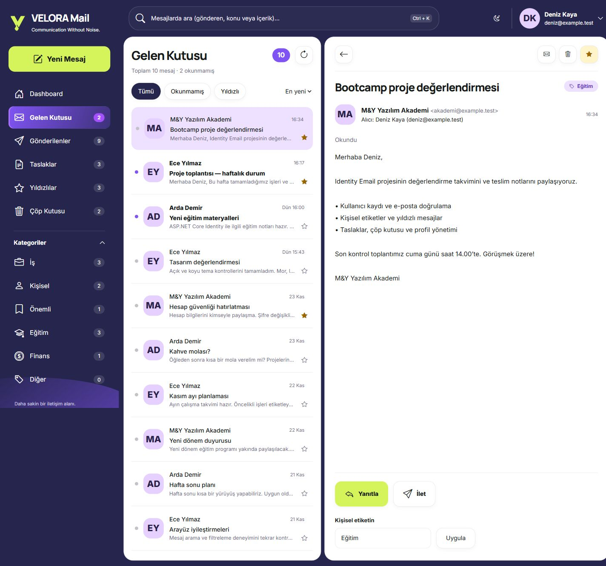
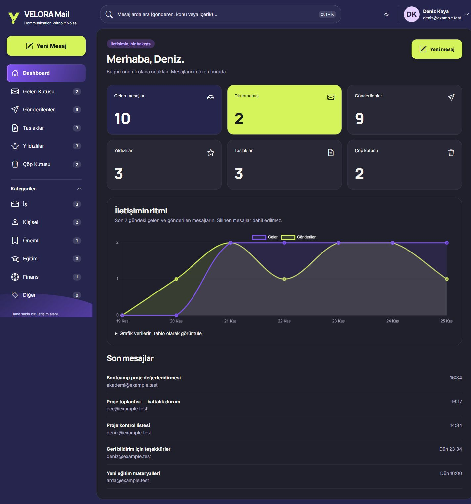
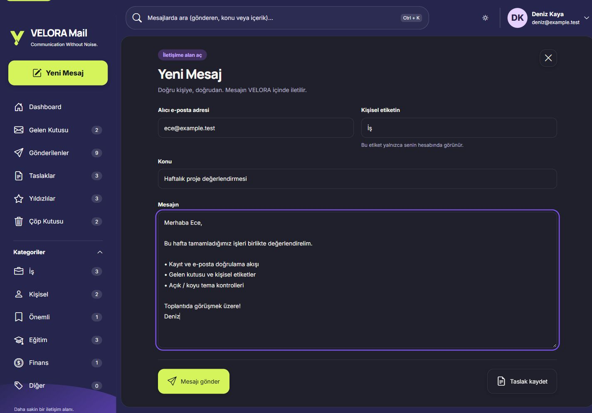
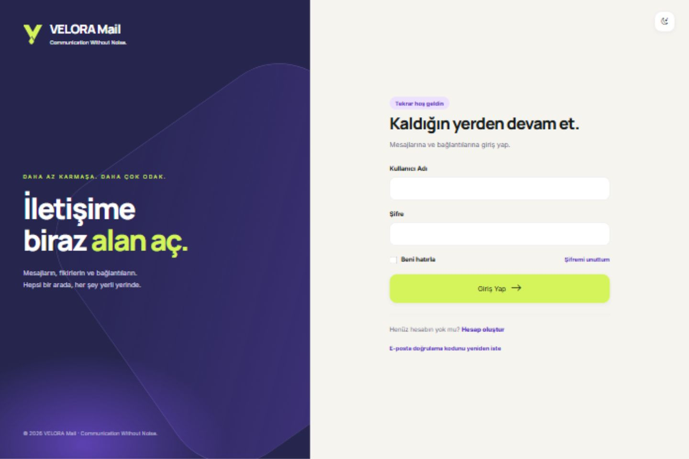
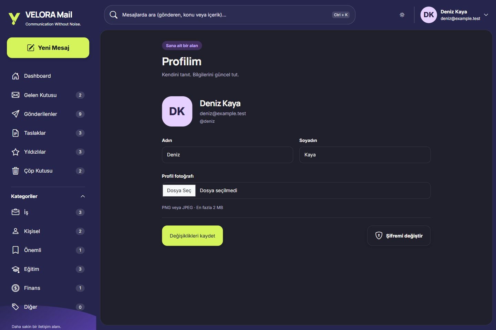
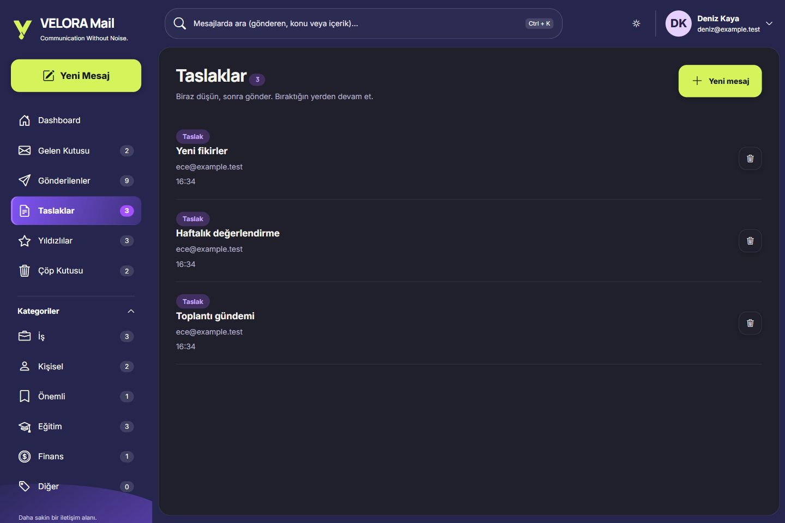
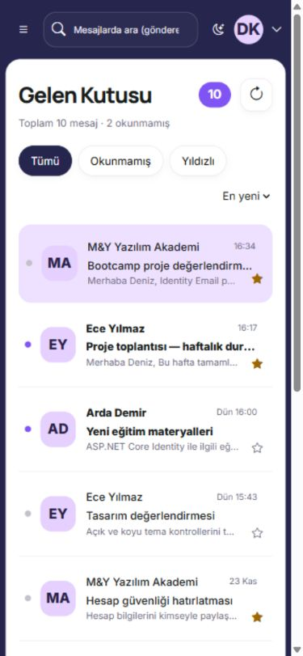
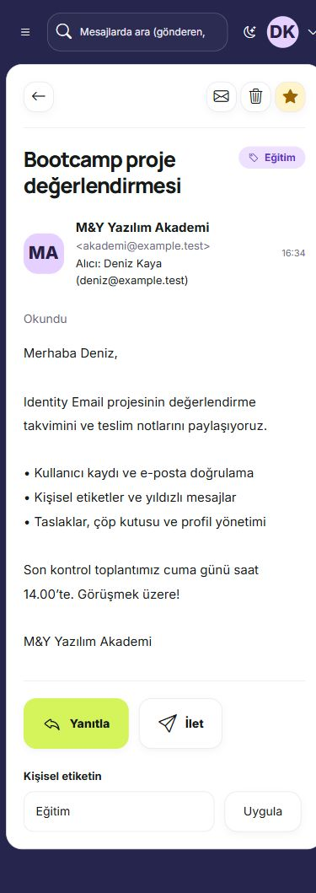

# ASP.NET Core MVC ile VELORA Mail

Kullanıcıların mesajlarını tek bir yerde yönetebilmesi için Kübra Nur Cemiloğlu tarafından geliştirilen, ASP.NET Core Identity tabanlı mesajlaşma uygulaması.

Proje, M&Y Yazılım Eğitim Akademi 12. Dönem Akşam Grubu’nun Identity Email Case Çalışması kapsamında geliştirildi. Eğitimde kurulan MVC, Identity ve Entity Framework Core yapısı korunarak kayıt, e-posta doğrulama ve kişisel posta kutusu işlemleri VELORA Mail arayüzünde bir araya getirildi.

## Proje Hakkında

VELORA Mail; gelen kutusu, gönderilenler, taslaklar, yıldızlılar ve çöp kutusunu aynı çalışma alanında sunar. Kullanıcılar kayıtlı kişilere mesaj gönderebilir, mesajlarını arayabilir, kişisel etiketlerle düzenleyebilir ve profil bilgilerini güncelleyebilir.

Mesajlar SQL Server’da saklanır ve uygulamaya kayıtlı kullanıcılar arasında iletilir. SMTP, hesap doğrulama ve şifre sıfırlama e-postaları için kullanılır. Kullanıcıların yazdığı mesajlar harici e-posta servislerine gönderilmez.

Lacivert, mor ve lime renklerini kullanan arayüz; açık/koyu tema, masaüstünde yan yana mesaj listesi ve detay görünümü, mobilde ayrı liste/detay akışı ile tasarlandı. Dashboard sayaçları ve son yedi günlük grafik verileri kullanıcının kendi kayıtlarından hesaplanır.

## Kullanılan Teknolojiler

- C# ve ASP.NET Core MVC
- ASP.NET Core Identity, cookie tabanlı kimlik doğrulama ve Data Protection
- Entity Framework Core ve SQL Server Express LocalDB
- Razor View Engine, Tag Helpers ve View Components
- HTML5, CSS3, Bootstrap, Bootstrap Icons ve JavaScript
- MailKit / MimeKit ile STARTTLS üzerinden SMTP
- Chart.js ile mesaj trafiği grafiği
- StbImageSharp ile profil fotoğrafı doğrulama

## Mimari ve Kullanılan Yaklaşımlar

- **MVC** controller’ları hesap, mesaj, taslak, profil ve dashboard isteklerini karşılar; Razor görünümleri ViewModel’lerle beslenir.
- **Code First ve Migration** veritabanı şemasını ve altı başlangıç kategorisini yönetir.
- **ASP.NET Core Identity** kullanıcı kaydı, şifre politikası, doğrulanmış hesapla giriş, beni hatırla, hesap kilitleme ve şifre sıfırlama işlemlerini sağlar.
- **Kullanıcıya özel mesaj durumu** yıldız, etiket ve çöp kutusu bilgisini mesajdan ayrı tutar. Bir kullanıcının silme veya etiketleme işlemi diğer katılımcının posta kutusunu değiştirmez.
- **Benzersiz kullanıcı/mesaj indeksi ve atomik yıldız güncellemesi** eşzamanlı isteklerde yinelenen durum kaydını ve kaybolan yıldız değişikliklerini önler.
- **LINQ ve async/await** ile arama, filtreleme, kişisel sayaçlar ve son yedi günlük istatistikler veritabanından oluşturulur.
- **View Components ve ortak Razor parçaları** menü, profil alanı, tema, hata ve posta kutusu bileşenlerini bir araya getirir.
- **Sunucu tarafı doğrulama ve CSRF koruması** form alanlarını ve POST isteklerini denetler. Mesaj göndereni ve gönderim tarihi sunucuda belirlenir; içerikler Razor tarafından HTML olarak kodlanır.
- **Dosya doğrulama** profil fotoğrafında MIME, gerçek PNG/JPEG biçimi, çözülebilir içerik, 2 MB dosya ve 4096 × 4096 piksel sınırlarını kontrol eder; dosyayı benzersiz adla saklar.

## Kullanılan Framework Sürümleri

| Teknoloji | Sürüm |
| --- | --- |
| .NET / ASP.NET Core | 9.0 |
| Identity EF Core / Entity Framework Core | 9.0.23 |
| EF Core SQL Server Provider / dotnet-ef | 9.0.23 |
| MailKit | 5.0.0 |
| Bootstrap | 5.3.3 |
| Bootstrap Icons | 1.11.3 |
| Chart.js | 4.4.8 |
| StbImageSharp | 2.30.16 |

## Özellikler

### Hesap ve Güvenlik

- Kullanıcı kaydı, parola tekrarı ve benzersiz e-posta kontrolü
- E-postaya gönderilen altı haneli kodla hesap doğrulama
- On dakika geçerli doğrulama kodu, deneme sınırı ve yeniden gönderim bekleme süresi
- Doğrulanmış hesapla giriş, beni hatırla ve güvenli çıkış
- Beş başarısız girişten sonra on beş dakika hesap kilitleme
- Süreli ve tekrar kullanılamayan Identity token’ıyla şifre sıfırlama
- Ad/soyad, profil fotoğrafı ve mevcut şifreyi doğrulayarak parola değiştirme

### Mesajlaşma ve Kişisel Posta Kutusu

- Kayıtlı kullanıcılar arasında yeni mesaj, yanıt ve iletme
- Gelen kutusu ve gönderilenlerde gerçek gönderen/alıcı bilgileri
- Gönderen adı, e-posta adresi, konu veya içerikle arama; `Ctrl + K` arama kısayolu
- Tümü, okunmamış ve yıldızlı filtreleri; en yeni / en eski sıralaması
- Görünür mesaj detayında otomatik okundu işaretleme ve yeniden okunmadı yapma
- Taslak kaydetme, düzenleme, gönderme ve silme
- Kişisel yıldızlar ve **İş, Kişisel, Önemli, Eğitim, Finans, Diğer** etiketleri
- Diğer katılımcıyı etkilemeden çöp kutusuna taşıma, geri yükleme ve kişisel kalıcı kaldırma
- 20.000 karaktere kadar mesaj gövdesi ve azami uzunluktaki içeriği kesmeden iletme

### Dashboard ve Arayüz

- Gelen, okunmamış, gönderilen, yıldızlı, taslak ve çöp kutusu sayaçları
- Son yedi günlük gelen/gönderilen mesaj grafiği ve erişilebilir veri tablosu
- Son mesajlara hızlı erişim
- Tercihi hatırlayan açık ve koyu tema
- Mobil menü, liste/detay geçişi, boş durumlar ve form geri bildirimleri
- Production ortamında özel 401, 403, 404 ve 500 hata sayfaları

## Ekran Görüntüleri

Görüntüler çalışan uygulamadan, ayrı bir demo veritabanındaki örnek hesap ve mesajlarla alındı. Görünen adlar ve `example.test` adresleri temsilidir; kişisel posta içerikleri veya gerçek hesap bilgileri kullanılmadı.

### Gelen Kutusu ve Mesaj Detayı



### Dashboard ve Koyu Tema



### Yeni Mesaj



<details>
<summary>Giriş, profil, taslak ve mobil ekranlar</summary>

#### Giriş Ekranı



#### Profil Yönetimi



#### Taslaklar



#### Mobil Gelen Kutusu



#### Mobil Mesaj Detayı



</details>

## Kurulum

Gereksinimler Windows, .NET 9 SDK ve SQL Server Express LocalDB’dir. Komutları çözüm dosyasının bulunduğu klasörde PowerShell ile çalıştırın. EF aracı proje içindeki manifest ile 9.0.23 sürümüne sabitlenmiştir.

```powershell
dotnet restore
dotnet tool restore

$localSettings = '.\MYAcademy_IdentityEmail\appsettings.Local.json'
if (-not (Test-Path $localSettings)) {
    Copy-Item '.\MYAcademy_IdentityEmail\appsettings.Local.example.json' $localSettings
}
```

Oluşan `appsettings.Local.json` dosyasında `Smtp:UserName`, `Smtp:Password` ve `Smtp:FromEmail` alanlarını kendi SMTP hesabınızla doldurun. Gmail kullanıyorsanız uygulama şifresini yerel dosyaya yazın. Örnek bağlantı, Windows kimlik doğrulamasıyla `VeloraMailLocal` adlı ayrı bir LocalDB veritabanını kullanır.

`App:PublicUrl`, doğrulama ve şifre sıfırlama e-postalarındaki bağlantıların kök adresidir; yerel HTTP profili için `http://localhost:5296` değerindedir.

```powershell
dotnet ef database update --project .\MYAcademy_IdentityEmail
dotnet run --project .\MYAcademy_IdentityEmail --launch-profile http
```

| Ekran | Yerel adres |
| --- | --- |
| Giriş | `http://localhost:5296/Login/SignIn` |
| Yeni hesap | `http://localhost:5296/Register/SignUp` |
| Dashboard | `http://localhost:5296/` |
| Gelen kutusu | `http://localhost:5296/Message/Inbox` |

İlk kullanımda hesap oluşturup e-postanıza gelen kodu doğrulayın. İkinci bir kayıtlı kullanıcıyla uygulama içi mesajlaşmayı deneyebilirsiniz. Depoda hazır kullanıcı hesabı, ortak giriş şifresi veya gerçek kullanıcı veritabanı bulunmaz.

### Yerel Ayarlar ve Gizlilik

Gerçek SMTP bilgileri `appsettings.Local.json` veya ortam değişkenleri üzerinden okunur. Yerel ayar dosyaları Git ve yayın çıktısı dışında tutulur; depodaki örnek ayar dosyasında kullanıcı adı ve şifre boş bırakılmıştır.

Yüklenen profil fotoğrafları, veritabanı dosyaları, yedekler, günlükler, geçici test oturumları ve yerel denetim raporları Git’e dahil edilmez. Migration dosyaları şemayı ve kategori başlangıç verisini içerir; kullanıcı hesaplarını veya mesaj içeriklerini taşımaz.

### Doğrulama

Uygulama ayrı bir test veritabanında **77 HTTP/SQL kontrolünden** geçirildi: 51 temel uygulama kontrolü, 4 kayıt/doğrulama kontrolü ve 22 ek regresyon kontrolü. Gerçek alıcılara test e-postası gönderilmedi. Kontroller kullanıcı izolasyonu, token/CSRF, taslaklar, çöp kutusu, eşzamanlı işlemler, uzun mesajlar ve profil fotoğrafı doğrulamasını kapsar.

Derleme başarılıdır. Korunan ders entity/model sınıflarında mevcut nullable uyarıları devam eder. Test araçları `verification/` klasöründedir; yalnızca kendileri için üretilen geçici veritabanlarını kullanırlar.

## Proje Yapısı

```text
MYAcademy_IdentityEmail/
  Context/           Identity ve EF Core veritabanı bağlamı
  Controllers/       Hesap, mesaj, taslak, profil ve dashboard işlemleri
  Entities/          Kullanıcı, mesaj, kişisel durum ve doğrulama modelleri
  Helpers/           E-posta şablonları, sayaçlar ve fotoğraf doğrulama
  Migrations/        Veritabanı şeması ve kategori başlangıç verisi
  Models/            Form ve sayfa ViewModel’leri
  ViewComponents/    Veriyle beslenen gezinme bileşenleri
  Views/             Razor görünümleri ve ortak VELORA parçaları
  wwwroot/           CSS, JavaScript, fontlar ve statik kütüphaneler
.config/             Projeye özel dotnet-ef araç manifesti
docs/screenshots/    Yalnızca örnek verilerle alınan ekran görüntüleri
verification/        İzole HTTP/SQL ve regresyon kontrol araçları
```

## Kaynak ve Teşekkür

Bu proje, M&Y Yazılım Eğitim Akademi 12. Dönem Akşam Grubu’nun Identity Email Case Çalışması temel alınarak geliştirildi. Eğitimdeki rehberliği için Murat Yücedağ’a teşekkür ederim.
